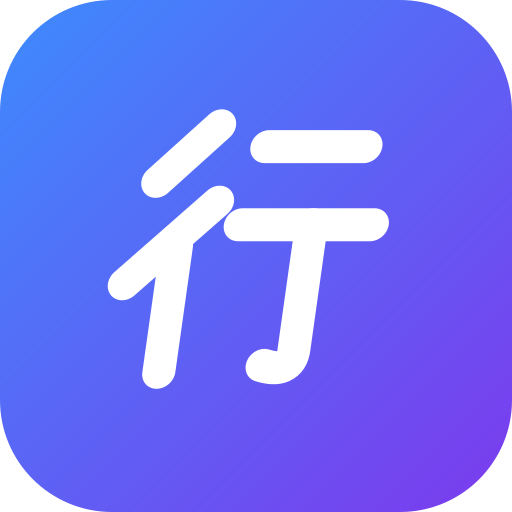

<p align="center"></p>

# Ikuzo

**行くぞ, "let's go!"** Ikuzo is a free, open-source anime tracker for Android and iOS. It needs no account, has no ads and does no tracking.

It keeps your watch lists, counts down to every next episode, notifies you when one airs and helps you find what to watch next, using data from **AniList**, **MyAnimeList** (its official API, plus [Jikan](https://jikan.moe)) and **AniDB**.

## Features

- **Lists:** Watching, Plan to watch, On hold, Completed and Dropped, with +1 episode, scores, filter and sort
- **Calendar:** your airing shows with live countdowns, plus the full weekly schedule
- **Episode notifications:** local reminders when new episodes air, with no server involved
- **Discover:** the current season, airing now, most popular, upcoming, top rated, top movies and a random pick
- **Search:** by title, or filtered by format, status, year and genre
- **Anime pages:** info, genres, synopsis, characters and voice actors, related shows, recommendations, reviews, community stats, opening and ending songs, and AniDB episode lists
- **Personal extras:** notes per episode, bookmarks, favourite shows and characters, "continue watching", and recommendations based on your list
- **Stats:** episodes watched, time spent, your score distribution and top genres
- **Backup:** export your library as JSON and restore it on another phone

## Sync with AniList and MyAnimeList

In **Settings → Accounts** you can connect AniList, MyAnimeList or both:

- **Connecting** imports your list (status, progress, score). If a show is in both your Ikuzo list and the service's, whichever copy changed most recently is kept.
- **Your changes go out automatically:** +1, status, score and deletions are sent to every connected account within a couple of seconds.
- **Offline:** changes wait in a queue and are sent when the app is opened again or you pull to refresh.
- **Expired sign-in:** changes stay queued until you tap **Reconnect**. Nothing is lost.
- **Changes made on the websites** come in when the app starts or you pull to refresh Home.

Sign-in uses each service's OAuth flow for apps: the implicit grant on AniList and PKCE on MyAnimeList. No client secret is involved, and tokens are kept in the Android Keystore or iOS Keychain. Shows removed on the website are not removed from Ikuzo, so a sync never deletes anything on your phone. Sign-in needs a development or release build; Expo Go cannot open the `ikuzo://` sign-in links.

## Data sources

| Source | Used for |
| --- | --- |
| AniList (default) | Browsing and details, plus exact next-episode times for every show, including MyAnimeList entries matched by ID |
| MyAnimeList (official API + Jikan) | Browsing and details; Jikan adds characters, reviews and opening and ending songs |
| AniDB (optional) | Episode titles and air dates |
| [ARM](https://arm.haglund.dev) | Matching the same show across AniList, MyAnimeList and AniDB |

You choose AniList or MyAnimeList for browsing in the side menu. Without an account your list lives on the phone (SQLite through TanStack DB). Connect AniList or MyAnimeList and that account owns the list: Ikuzo shows it, edits go straight to it (queued while offline), and a second connected account receives a copy of every change. Removals wait 10 seconds so they can be undone, large batches of removals wait for your OK, and notes, bookmarks and favourites stay on the phone and in backups.

### Enabling AniDB

AniDB requires every app to register a client and bans clients that send too many requests:

1. Register an "HTTP API" client at <https://anidb.net/software/add>.
2. Copy `apps/mobile/.env.example` to `apps/mobile/.env` and set `EXPO_PUBLIC_ANIDB_CLIENT` and `EXPO_PUBLIC_ANIDB_CLIENT_VERSION`.

Ikuzo then waits at least 2.5 seconds between AniDB requests and caches each show for 24 hours. AniDB's API only works over plain HTTP, so a config plugin allows unencrypted traffic to `api.anidb.net` and nowhere else.

## Repository layout

| Path | What it is |
| --- | --- |
| `apps/mobile` | Expo SDK 58 app (Expo Router, TanStack Query, TanStack DB) |
| `apps/web` | Astro 7 website |
| `packages/anime` | `@ikuzo/anime`: typed clients for MyAnimeList, Jikan, AniList and AniDB that return the same data shapes, plus ID mapping, airing-time maths and the sync planner (with unit tests) |
| `packages/typescript-config` | Shared TypeScript config |

## Development

You need **Node 24+** and **pnpm** (`corepack enable`).

```bash
pnpm install
pnpm --filter mobile start      # Expo dev server: press a for Android, i for iOS, w for web
pnpm --filter web dev           # website on http://localhost:4321/ikuzo
```

Notifications and other native modules need a [development build](https://docs.expo.dev/develop/development-builds/introduction/) (`pnpm --filter mobile exec expo run:android`) rather than Expo Go.

### Checks

```bash
pnpm check         # oxlint + oxfmt through Ultracite
pnpm fix           # auto-fix lint and formatting
pnpm check-types   # TypeScript (tsc and astro check)
pnpm build         # builds the website
pnpm --filter mobile export   # bundles the Android app with Metro
```

Linting and formatting use [oxc](https://oxc.rs) (oxlint with type-aware rules, and oxfmt, which also formats `.astro` files) set up by [Ultracite](https://www.ultracite.ai). Lefthook runs the fixer and the type check before each commit, and the build before each push.

## Contributing

Issues and pull requests are welcome. Run `pnpm fix` and `pnpm check-types` before you open a PR.

## License

Ikuzo is free software under the [GNU General Public License v3.0 or later](LICENSE). You can use, study, share and change it; versions you distribute must stay open under the same licence.

## Disclaimer

Ikuzo is an independent project and is not affiliated with AniList, MyAnimeList, Jikan or AniDB. Anime titles and artwork belong to their respective owners.
